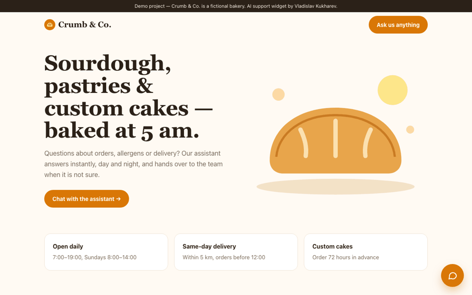

# Crumb & Co. — AI customer-support widget

> **Demo project.** Brand and data are fictional. Built by Vladislav Kukharev as a portfolio piece.

Chat widget for a fictional bakery that answers from the business FAQ and hands off to a human when unsure.

**Live demo:** https://vk-crumb-ai-demo.netlify.app · **Code:** https://github.com/Levelupacademybot/crumb-ai-support-widget

## Features
- Embeddable floating widget with suggestions and typing indicator
- Answers grounded on the FAQ, shows the source used
- Human handoff with email capture on low confidence
- Browser demo uses an in-page TF-IDF retriever (no API key); production mode uses the Claude API via a Netlify serverless function (`netlify/functions/chat.mjs`)

## Stack
HTML, CSS, JavaScript · Netlify Functions · Claude API

## Run
Open `index.html`. For LLM mode deploy to Netlify and set `ANTHROPIC_API_KEY`.

## License
MIT
